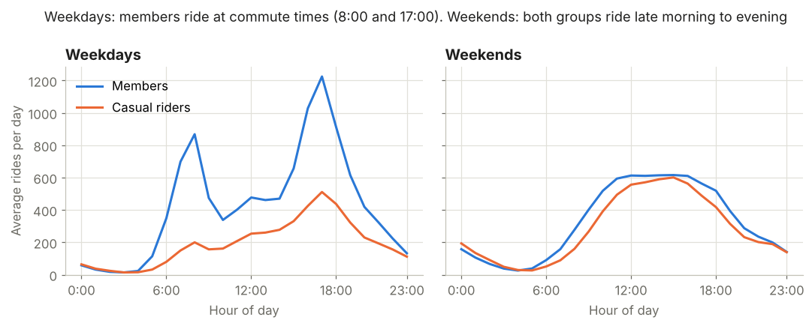
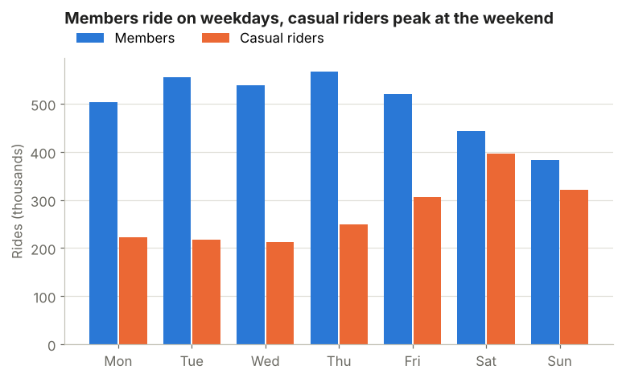
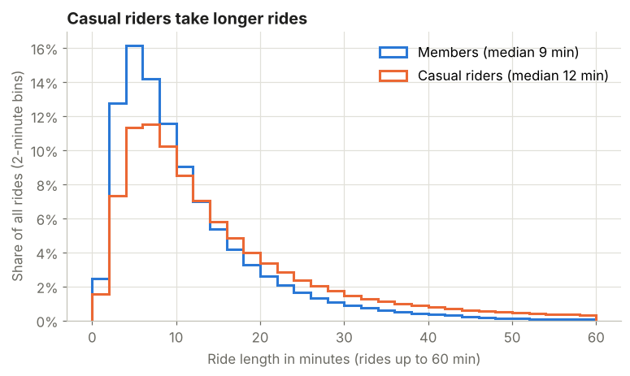
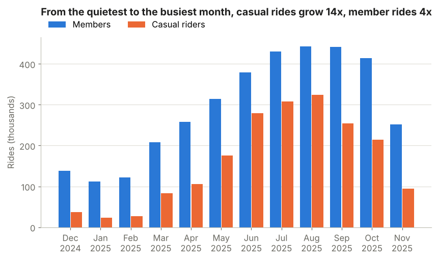
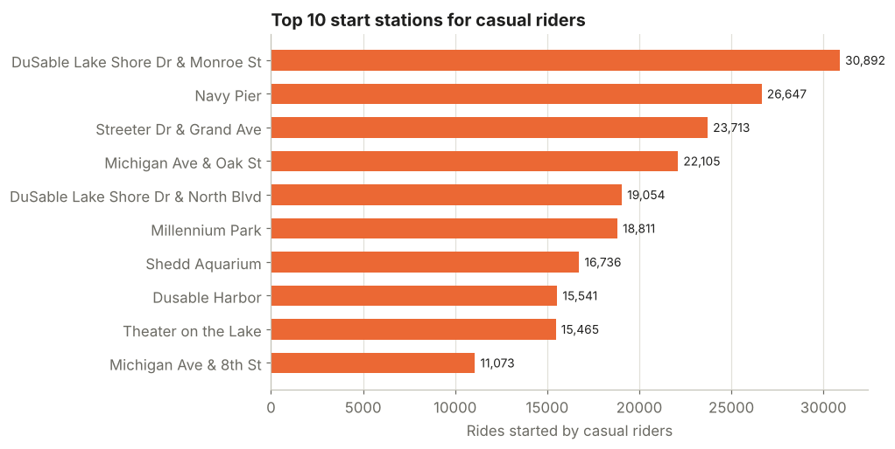

# Bike-Share Analysis: How Members and Casual Riders Use Bikes Differently

An analysis of **5.4 million bike-share rides** in Chicago (December 2024 to November 2025). It compares annual members with casual riders, to help a marketing team turn casual riders into members.

This is the capstone case study of the **Google Data Analytics Professional Certificate** (the "Cyclistic" case). I rebuilt it in Python using a full year of recent public Divvy data, with tested cleaning code and reproducible charts.

**Tools:** Python (pandas, NumPy, Matplotlib), Jupyter, pytest

---

## Business question

Annual members bring in more revenue than casual riders, who pay per ride or per day. The marketing team wants to convert casual riders into members. The question is:

> **How do annual members and casual riders use the bikes differently?**

## Data

- **Source:** [Divvy public trip data](https://divvy-tripdata.s3.amazonaws.com/index.html), published by Lyft Bikes and Scooters under the [Divvy Data License Agreement](https://divvybikes.com/data-license-agreement)
- **Period:** 12 monthly files, December 2024 to November 2025
- **Size:** 5,590,832 rides before cleaning
- **Each row:** one ride, with start and end time, stations, coordinates, bike type, and rider type (`member` or `casual`). The data contains no personal information.

## Cleaning

| Step | Rides removed |
|---|---:|
| Duplicate ride IDs | 0 |
| Rides starting outside the 12-month period | 13 |
| Rides under 1 minute, ending before they start, or over 24 hours | 152,382 |
| **Clean rides kept** | **5,438,437 (97.3%)** |

About 20% of rides have no start station name. They stay in all time-based analysis and are left out only from the station ranking. The cleaning rules are covered by automated tests in `tests/`.

---

## Findings

| | Members | Casual riders |
|---|---:|---:|
| Share of rides | 64.6% | 35.4% |
| Median ride length | 8.7 min | 11.9 min |
| Rides over 30 minutes | 5.4% | 15.6% |
| Median distance (straight line) | 1.65 km | 1.66 km |
| Median speed | 12.4 km/h | 10.0 km/h |
| Rides on weekends | 23.5% | 37.3% |
| Rides in summer (Jun to Aug) | 35.7% | 47.3% |
| Round trips (same start and end station) | 1.5% | 5.6% |
| Busiest day | Thursday | Saturday |

### 1. Members commute, casual riders ride for leisure
On weekdays, member rides peak sharply at **8:00 and 17:00**, which are commute times. At weekends both groups ride from late morning to evening. Casual riders also have a weekday peak at 17:00, which suggests some of them already use the bikes to get home from work.



### 2. Casual riders are a weekend crowd
Members ride most from Tuesday to Thursday. Casual riders ride most on Saturday and Sunday, and **37% of their rides are at weekends**, compared with 24% for members.



### 3. Same distance, but casual riders take longer
Both groups travel about the same distance (median 1.65 km), but casual riders take **37% longer** (11.9 vs 8.7 minutes) and ride more slowly. They are **nearly 3 times more likely** to ride for over 30 minutes and almost **4 times more likely** to return to the station they started from. That's typical of sightseeing, not getting somewhere.



### 4. Casual riding depends heavily on the season
From the quietest month (January) to the busiest (August), casual rides grow **14 times** and member rides grow **4 times**. Almost half (47%) of all casual rides happen in June, July and August.



### 5. Casual riders start at the lakefront and tourist sites
The top start stations for casual riders are along the lakefront and at attractions: DuSable Lake Shore Dr, Navy Pier, Streeter Dr & Grand Ave, Millennium Park and Shedd Aquarium.



Bike type is **not** a difference. Both groups use electric bikes for about two thirds of their rides (65% casual, 63% members).

---

## Recommendations

1. **Launch a membership campaign in spring (April to May)**, before casual riding grows sharply in June. Consider a summer or weekend membership as an easier first step toward annual membership.
2. **Advertise at the top 10 casual-rider stations** on the lakefront and at attractions, with posters at the docks and in-app offers when a ride starts there.
3. **Show long-ride casual riders what their rides would cost with a membership.** 15.6% of casual rides are over 30 minutes, so these riders are the best group for a cost comparison.
4. **Target weekday-evening casual riders with a commuter message.** The 17:00 casual peak shows a group that already rides like members.

## Limitations

- The data has no rider IDs, so it counts **rides, not people**. It can't show how many casual riders are tourists who are unlikely to ever become members.
- About 20% of rides have no start station name.
- Distance is measured in a straight line between the start and end points, not along the actual route.
- No pricing or revenue data is included, so the cost comparison in recommendation 3 needs Divvy's current prices.

---

## How to run

```bash
pip install -r requirements.txt
python src/download_data.py        # downloads Dec 2024 to Nov 2025 into data/
jupyter notebook bike_share_analysis.ipynb
pytest                             # runs the data-cleaning tests
```

## Project structure

```
bike-share-analysis/
├── bike_share_analysis.ipynb   # full analysis, step by step
├── src/
│   ├── bikeshare.py            # loading, cleaning, features, summary
│   ├── charts.py               # chart functions
│   └── download_data.py        # downloads the monthly data files
├── tests/test_bikeshare.py     # tests for the cleaning rules
├── pytest.ini
├── images/                     # charts used in this README
├── results/summary.json        # all numbers behind the findings
└── requirements.txt
```

## Author

**Sanaz Bayat**, MSc Computer Science student at the University of Passau
[LinkedIn](https://www.linkedin.com/in/sanazbayat)
